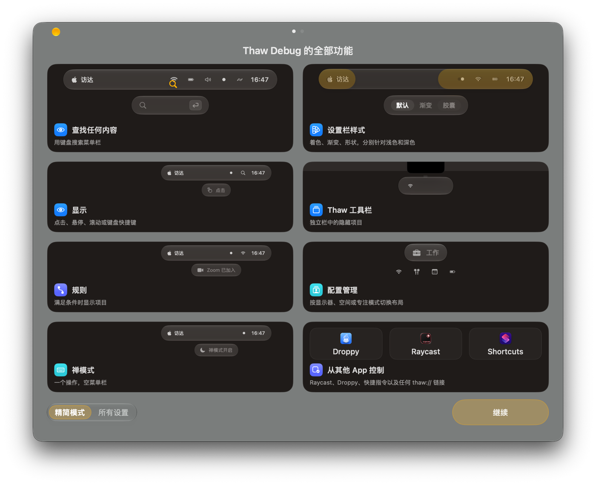

# Thaw-CN

**Thaw 的非官方简体中文版** —— macOS 菜单栏管理器。

[](https://github.com/maowei-cmd/Thaw-CN/actions/workflows/build.yml)

> 本项目基于开源项目 [thaw-app/Thaw](https://github.com/thaw-app/Thaw)（GPL-3.0）修改而来，**不是官方版本**，与上游团队没有隶属或背书关系。上游不为本版本提供支持；遇到上游相关问题请到上游仓库反馈，本仓库只处理汉化和本 fork 的改动。

Thaw 会隐藏你不需要的菜单栏项目，在需要时把它们带回来，并支持搜索、分组、配置、布局编辑和禅模式。免费、无订阅、无账号、无跟踪。

## 界面



## 功能

- 隐藏 / 显示菜单栏项目，支持“显示”“隐藏”“永久隐藏”三个区域
- Thaw 工具栏：在菜单栏下方展示隐藏项目，可点击、可搜索
- 布局编辑：拖动排列、分组、间隔项目、按名称排序
- 配置：按显示器、空间或专注模式自动切换布局
- 外观：菜单栏背景、形状、边框、着色、深浅色分别设置
- 禅模式、交换栏、快捷键、`thaw://` 自动化、脚本钩子
- 完整的简体中文界面

## 系统要求

- **macOS 27**（本分支为 Thaw 3，使用 macOS 27 的 MenuBarAgent）
- 从源码构建需要 **Xcode 27**
- Apple 芯片或 Intel Mac（以你本地构建的架构为准）

## 安装

本项目不提供经过公证的安装包。你可以：

1. 从 [Releases](https://github.com/maowei-cmd/Thaw-CN/releases) 下载未签名的 zip（如果发布了），解压后把 `Thaw.app` 拖到“应用程序”；
2. 或按下面的“从源码构建”自行构建。

首次打开时 macOS 可能提示“无法验证开发者”，请在“系统设置”→“隐私与安全性”中点击“仍要打开”。

### 安装前请注意

- 本 fork **沿用官方 Bundle ID `com.stonerl.Thaw`**，因此不能和官方 Thaw 同时安装或同时运行。
- 安装前请退出官方 Thaw。两者会共用偏好设置和辅助功能授权；建议先备份：

```sh
defaults export com.stonerl.Thaw ~/Desktop/thaw-backup.plist
```

- 首次启动需要授予：
  - **辅助功能**：读取和移动菜单栏项目（必需）
  - **菜单栏布局访问权限**：直接写入系统布局表（推荐）
  - **屏幕录制**：在 Thaw 工具栏/布局/搜索中显示真实图标（可选）

## 从源码构建

```sh
git clone https://github.com/maowei-cmd/Thaw-CN.git
cd Thaw-CN
open Thaw.xcodeproj
```

在 Xcode 中选择你的开发团队（或在命令行传入 `DEVELOPMENT_TEAM`），然后：

```sh
./scripts/devrun.sh --debug
```

`devrun.sh` 会构建 **Thaw Debug**（Bundle ID `com.stonerl.Thaw.debug`），安装到 `/Applications/Thaw Debug.app` 并启动。Debug 版与官方版使用不同的偏好和权限，适合开发测试。

也可以手动构建 Release：

```sh
xcodebuild -project Thaw.xcodeproj -scheme Thaw -configuration Release \
  -destination 'platform=macOS' \
  CODE_SIGN_IDENTITY=- CODE_SIGNING_REQUIRED=NO CODE_SIGNING_ALLOWED=NO build
```

未签名/ad-hoc 签名可以运行，但辅助功能授权在每次重新签名后可能需要重新授予；App Group 和 Control Center 控件在 ad-hoc 下可能不可用。想完整体验请使用个人开发者 Team 签名。

## 简体中文化

- 翻译直接维护在 `Thaw/Resources/Localizable.xcstrings`，共 **1875 条**，其中 **1851 条**为中文；其余为纯占位符、品牌名、单位或空键（见 `l10n/zh-Hans/skip.json`）。
- 翻译流程、术语表和校验工具在 [`l10n/zh-Hans`](l10n/zh-Hans/README.md)，工具在 `scripts/localization/`。
- 校验会检查占位符、位置参数、复数、Markdown、`inflect` 注解、空白，以及“除 zh-Hans 外其他语言不变”。
- 发现翻译问题请开 issue，附上英文原文和截图。

当前例外：

- `ThawExtras` 的替身 App 没有用户文案（名称来自 Apple 项目本身），未单独翻译。
- `ThawControls`（控制中心控件）有少量文案；如你需要，可在后续版本补齐。

## 更新

**本 fork 已关闭 Sparkle 自动更新**。上游的 appcast 会把本版本替换成官方英文版，因此这里不连接更新服务器。

要升级，请拉取本仓库的新版本并重新构建/替换 App。上游的更新说明仍可在 [上游仓库](https://github.com/thaw-app/Thaw) 查看。

## 双屏菜单栏说明

macOS 27 的菜单栏由系统进程 `MenuBarAgent` 绘制，并且会为每台显示器各建一个窗口。实测（macOS 27.0.1）发现：**微信、输入法菜单、万年历** 这三个旧式状态项目不会出现在副屏的菜单栏上；**退出 Thaw 后仍然如此**，因此这是 macOS 27 本身的绘制限制，不是 Thaw 少画了图标。当前无法通过 Thaw 强制 macOS 在副屏原生绘制这些项目。

本 fork 的处理方式：

- 读取每块显示器自己的 MenuBarAgent 窗口，检测“主栏有、该显示器没有”的可见项目；
- 在该显示器打开 Thaw 工具栏时，把这些缺失项目追加到工具栏中，仍可点击打开；
- 点击时使用实际绘制该项目的菜单栏显示器转发，避免在没有图标的位置误点；
- 修复了从副屏点击/悬停时 Thaw 工具栏仍开到活动显示器的问题；
- 不会把缺失项目当成可点击的“幽灵”目标。

**建议**：在该显示器的“显示”设置中，把隐藏项目的显示方式设为 **Thaw 工具栏**。这样在副屏打开工具栏时，微信、输入法、万年历会跟隐藏项目一起出现在工具栏里。

如果你在两块屏幕上看到图标数量/顺序/间距不一致，请附上 `系统设置 → 显示器` 的排列截图和 `defaults read com.stonerl.Thaw` 的相关输出开 issue。

## 与官方 Thaw 的关系

- 本项目是 GPL-3.0 的开源衍生作品，保留上游版权与许可。
- 不是官方版本，不使用上游团队名义提供支持。
- 本 fork 的主要改动：简体中文本地化、中文 README、关闭自动更新、双屏菜单栏改进。
- 上游项目主页：<https://github.com/thaw-app/Thaw>；官网：<https://www.getthaw.app>。

## 致谢

- 上游作者 Toni Förster 及所有 Thaw 贡献者、翻译者。
- Thaw 起源于 Jordan Baird 的 [Ice](https://github.com/jordanbaird/Ice)。
- 本 fork 的简体中文翻译与双屏改进由 Thaw-CN 贡献者完成。

## 许可证

本项目沿用上游的 **GPL-3.0**，详见 [LICENSE](LICENSE) 与 [LICENSE-EXCEPTION](LICENSE-EXCEPTION)。上游版权归 Toni Förster 等人所有；本 fork 的修改版权归 Thaw-CN 贡献者所有。

“Thaw” 是上游项目的名称，本仓库仅作描述性使用，不主张商标权。
